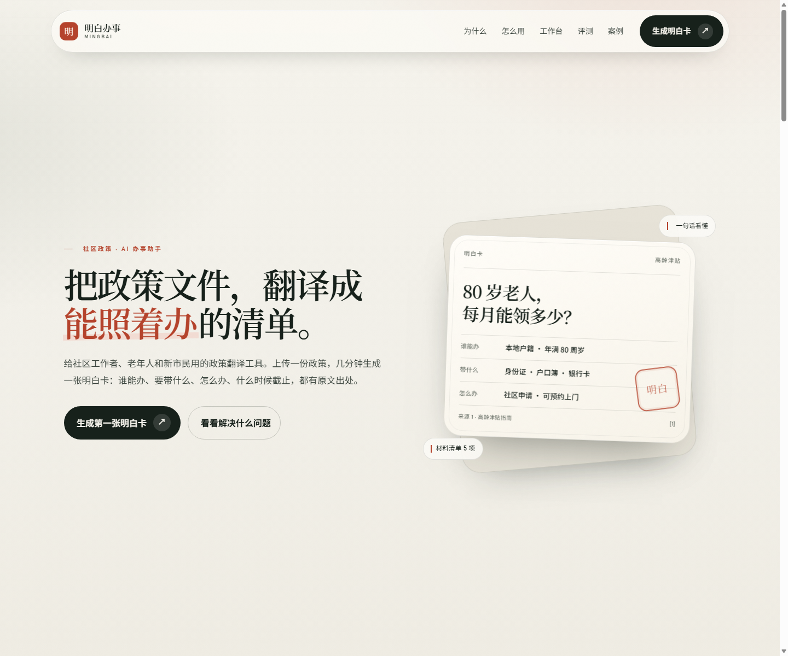
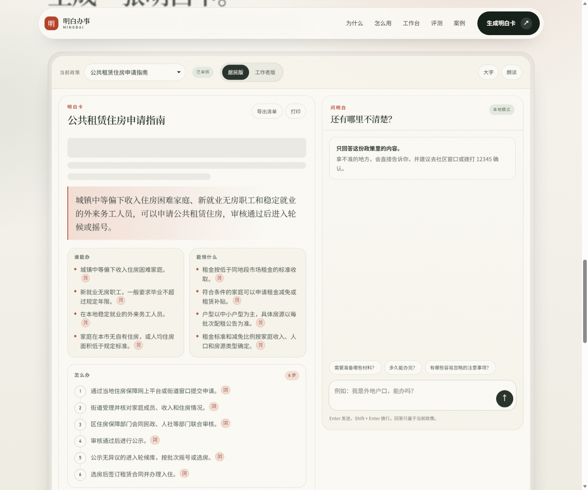
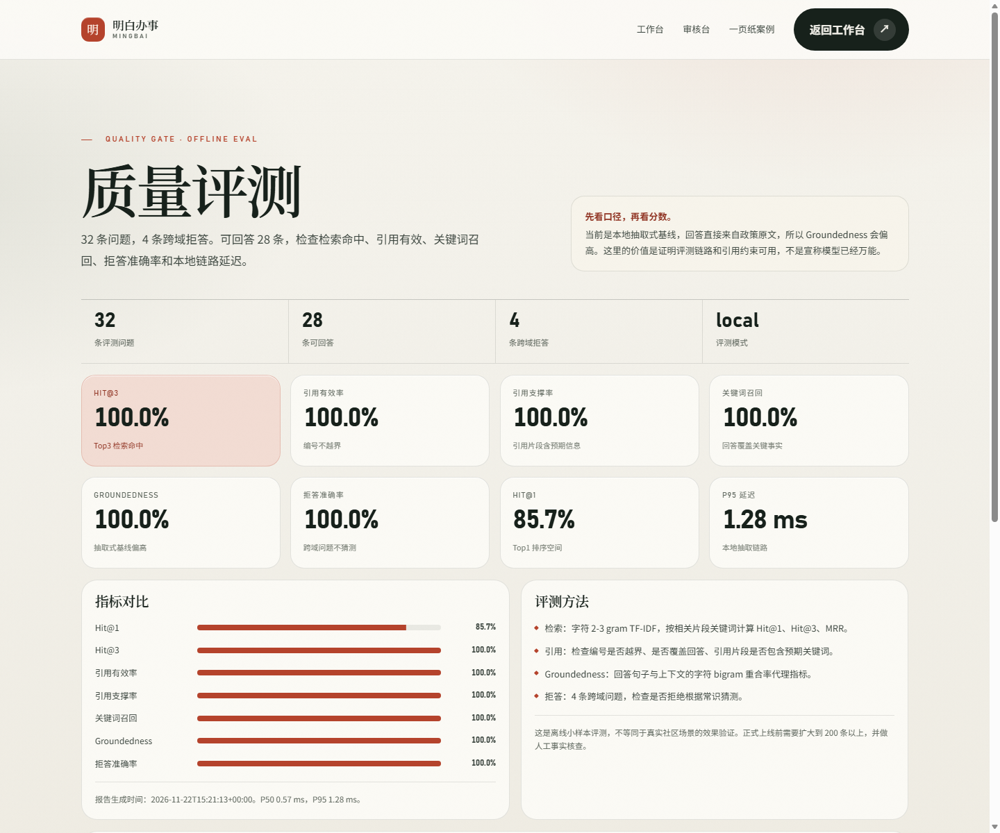
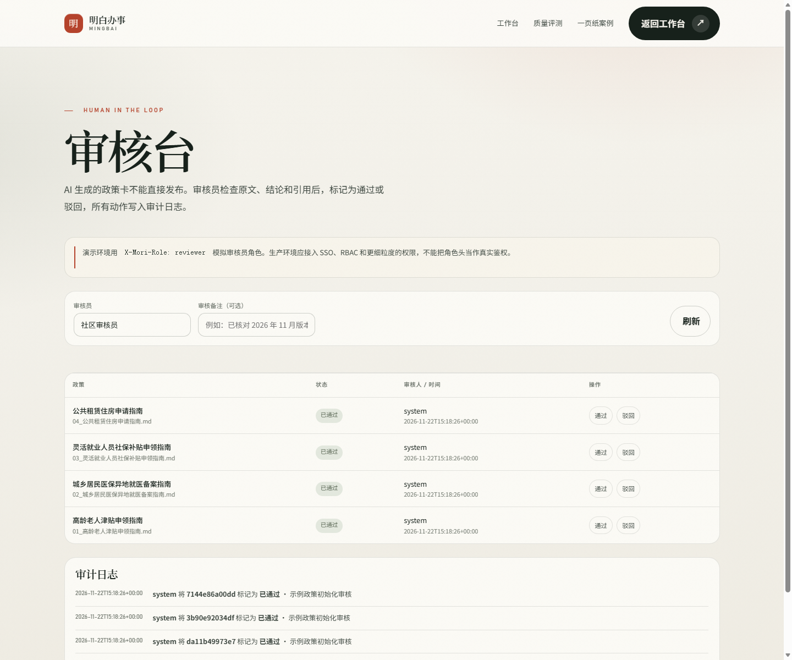

# 明白办事

> 把政策文件，翻译成一张能照着办的清单。

面向社区工作者、老年人和新市民的 AI 政策助手。上传一份 txt / md 政策，几分钟生成一张带原文引用的「明白卡」：谁能办、能领什么、要带什么、怎么办、什么时候截止、常见坑。

这个项目不是通用聊天框。它围绕一个真实的社会场景做窄而深的工作流：政策原文 → 结构化办事卡 → 可勾选材料清单 → 有出处的问答 → 可复制回复 / 打印 / 导出。

## 界面预览









## 为什么做

- 政策不是没有，是看不懂。关键条件藏在术语、附件和长段落里，老人和新市民最容易卡住。
- 材料清单分散在不同章节，少带一样就要再跑一趟。
- 同一个问题，社区窗口每天要回答几十遍，经验留在个人脑子里，没有变成可复用的能力。

「明白办事」把这三件事压缩成一张卡：居民照着卡准备材料，工作者照着卡转述，新人照着卡上手。

## 功能

- 政策翻译：自动拆出谁能办、待遇标准、所需材料、办理流程、时限、注意事项和咨询方式。
- 原文可追溯：每条结论带 `[n]` 引用，展开来源即可核对原文。
- 两种视角：居民版用大白话；工作者版生成可直接转述的回复和高频追问。
- 材料清单：可勾选、记录进度、导出 Markdown、打印。
- 适老化：大字模式、浏览器朗读、键盘可操作、移动端单列布局。
- 不串政策：问答锁定当前 `doc_id`，回答只基于当前政策。
- 人工审核：政策默认待审核，审核台可标记通过或驳回，所有动作写入审计日志。
- 质量评测：32 条离线问题，检查 Hit@3、引用有效性、引用支撑、关键词召回、拒答和延迟。
- 可观测性：请求 ID、结构化日志、Prometheus 指标、限流、安全响应头和 readiness 探针。
- 双模式：没有 API Key 时使用本地 TF-IDF 检索和抽取式回答；配置 `OPENAI_API_KEY` 后切换到在线模型，失败自动回退。

## 效果数据

以下数据来自本机离线演示，测试环境没有外网，使用本地模式：

| 指标 | 结果 |
| --- | --- |
| 示例政策 | 4 份 |
| 可追溯片段 | 12 个 |
| 本地问答响应 | 约 0.6-0.8 秒 |
| 平均材料清单 | 3-7 项 |
| 平均办理流程 | 3-6 步 |
| 预计节省 | 约 128 分钟（演示估算） |
| 离线评测 | 32 条问题，Hit@3 100%，引用有效 100%，拒答 100% |
| Hit@1 排序 | 85.7%，4 条 Top1 未命中但 Top3 命中 |
| 自动化测试 | 26 个全部通过 |
| 硬失败样例 | 0 条 |
| 响应式检查 | 桌面 1440px 与手机 390px 均无横向溢出 |

估算口径：人工整理 30 分钟 / 政策、助手 5 分钟；人工问答 6 分钟、助手 0.5 分钟。数据只用于说明产品价值，实际效果需要在社区试点中验证。

## 工程质量

- 评测：32 条问题，28 条可回答，4 条跨域拒答；Hit@3 100%，引用有效/覆盖/支撑 100%，拒答 100%，Top1 85.7%，P95 约 1ms。
- 测试：26 个 unittest 覆盖切块、检索、政策抽取、问答范围、拒答、上传删除、评测指标、审核、限流和指标输出。
- 治理：AI 生成政策卡默认待审核，审核动作写入 `audit_logs`。演示用 `X-Mori-Role` 模拟角色，生产应接 SSO / RBAC。
- 可观测性：`X-Request-ID`、JSON 访问日志、`/api/metrics`、`/api/live`、`/api/ready`。
- 安全：上传限制、参数化 SQL、CSP、安全响应头、240 请求/分钟/IP 限流。
- 交付：Dockerfile、docker-compose、GitHub Actions（Python 3.11 / 3.12 / 3.13 + Docker build）、Makefile。

详细材料：[作品集技术说明](docs/PORTFOLIO.md)、[评测报告](docs/EVALUATION.md)、[运行与运维](docs/OPERATIONS.md)。

## 架构

```text
浏览器（原生 HTML / CSS / JS）
   │  fetch + SSE
   ▼
FastAPI
   ├─ middleware：请求 ID、结构化日志、Prometheus、限流、安全头
   ├─ documents 路由：上传、解码、切块、入库、删除
   ├─ policy 路由：政策原文 → 明白卡结构化抽取
   ├─ chat 路由：当前政策检索、意图识别、SSE 流式回答
   ├─ reviews 路由：人工审核 + 审计日志
   ├─ eval 路由：最新离线评测报告
   ├─ system 路由：live / ready / metrics
   └─ stats 路由：文档数、片段数、问答数、耗时和节省估算
   │
   ├─ SQLite：documents / chunks / queries / audit_logs
   ├─ scikit-learn：字符 n-gram TF-IDF 检索
   ├─ OpenAI（可选）：chat completions 流式回答
   └─ Docker / GitHub Actions：构建、测试、评测质量门
```

关键设计：

- 单政策上下文：问答只取当前 `doc_id` 的片段，避免跨政策串答。
- 稳定引用：片段按原文顺序编号，回答里的 `[n]` 和来源面板一一对应。
- 中文检索：字符 2-3 gram TF-IDF，不依赖分词器和向量库，离线可跑。
- 意图兜底：口语问句零命中时，回退当前政策全文，再按「材料 / 流程 / 时限 / 待遇 / 条件 / 注意事项」抽字段。
- 降级策略：在线模型失败时自动切换到本地抽取式回答，演示不中断。

## 技术栈

- Python 3.13 / FastAPI / uvicorn
- SQLite（stdlib）
- scikit-learn TF-IDF
- 原生 HTML / CSS / JavaScript（零构建）
- SSE（Server-Sent Events）
- unittest + FastAPI TestClient（26 个测试）
- Prometheus 文本指标、请求 ID、结构化日志、令牌桶限流
- 人工审核 + 审计日志
- Docker、docker-compose、GitHub Actions、Makefile
- Edge 无头浏览器 + CDP 做真实布局 QA
- 字体：Noto Serif SC / Noto Sans SC（本机可用，失败时回退宋体 / 雅黑）

## 快速开始

要求：Python 3.11 及以上，推荐 3.13。前端不需要 Node.js。

```powershell
cd outputs/mori/backend
python -m uvicorn app.main:app --host 127.0.0.1 --port 8000
```

也可以直接运行：

```powershell
./run.ps1
```

打开 [http://127.0.0.1:8000](http://127.0.0.1:8000)。

首次启动会自动创建 SQLite 数据库，并导入 `backend/sample_docs/` 下的 4 份示例政策。示例政策仅用于产品演示，具体以当地官方最新发布为准。

### Docker

```powershell
docker compose up --build
```

当前开发环境的 Docker daemon 未启动，所以镜像没有在本地实际构建；GitHub Actions 里包含 Docker build job。生产镜像使用非 root 用户、HEALTHCHECK 和 `/api/ready` 探针。

如果换一台机器且依赖缺失：

```powershell
cd backend
python -m venv .venv
.venv\Scripts\Activate.ps1
pip install -r requirements.txt
python -m uvicorn app.main:app --host 127.0.0.1 --port 8000
```

### 可选：接入在线模型

复制 `.env.example` 为 `.env`，填写：

```dotenv
OPENAI_API_KEY=你的 Key
OPENAI_BASE_URL=https://api.openai.com/v1
MORI_MODEL=gpt-4o-mini
```

不配置也能完整运行。在线模型不可用时会自动回退本地模式。

## API

| 方法 | 路径 | 说明 |
| --- | --- | --- |
| GET | `/api/health` | 健康检查、当前模式 |
| GET | `/api/documents` | 文档列表 |
| POST | `/api/documents` | 上传 txt / md / csv，multipart 字段名 `files` |
| DELETE | `/api/documents/{id}` | 删除文档和片段 |
| GET | `/api/policy/{id}/card` | 生成明白卡 |
| POST | `/api/chat/stream` | 当前政策问答，SSE 流式返回 |
| GET | `/api/reviews` | 审核列表和审计日志 |
| POST | `/api/reviews/{id}` | 审核政策，演示需 `X-Mori-Role: reviewer` |
| GET | `/api/eval/latest` | 最新离线评测报告 |
| GET | `/api/live` | 存活检查 |
| GET | `/api/ready` | 就绪检查（数据库可用） |
| GET | `/api/metrics` | Prometheus 文本指标 |
| GET | `/api/stats` | 文档、片段、问答和节省估算 |
| POST | `/api/extract` | 按问题抽取相关原文片段 |

## 项目结构

```text
mori/
├─ backend/
│  ├─ app/
│  │  ├─ api/            # documents / policy / chat / reviews / eval / system / stats
│  │  ├─ answer.py       # 意图识别、本地抽取式回答、提示词
│  │  ├─ chunking.py     # 段落感知切块，保留 Markdown 结构
│  │  ├─ config.py       # 环境变量和 .env 加载
│  │  ├─ db.py           # SQLite schema、审核、审计和仓储函数
│  │  ├─ llm.py          # OpenAI 流式客户端
│  │  ├─ observability.py # 请求 ID、日志、Prometheus、限流、安全头
│  │  ├─ policy.py       # 政策 → 明白卡结构化抽取
│  │  ├─ qa.py           # 单政策上下文构建（chat/eval 共用）
│  │  ├─ retrieval.py    # 字符 n-gram TF-IDF 检索
│  │  └─ main.py         # FastAPI 入口和静态资源
│  ├─ eval/              # gold_set、评测脚本、report.json/md/csv
│  ├─ sample_docs/       # 4 份示例政策
│  ├─ tests/             # 26 个 unittest + TestClient
│  └─ requirements.txt
├─ frontend/
│  ├─ index.html         # 主页面
│  ├─ styles.css         # 市民 editorial 视觉系统
│  ├─ app.js             # 明白卡渲染、SSE、上传、导出、朗读
│  ├─ eval/              # 质量评测看板
│  ├─ review/            # 人工审核台
│  └─ case-study/        # 一页纸案例网页版
├─ case-study/
│  ├─ 明白办事_AI应用案例.md
│  └─ 明白办事_AI应用案例.pdf
├─ docs/
│  ├─ PORTFOLIO.md       # 系统设计、取舍、评测、扩展
│  ├─ OPERATIONS.md      # 运行、监控、限流、备份、事故处理
│  ├─ EVALUATION.md      # 评测方法和结果
│  ├─ DESIGN.md          # 视觉设计说明
│  └─ VIBE_CODING_LOG.md # AI 辅助开发记录
├─ Dockerfile
├─ docker-compose.yml
├─ Makefile
├─ .github/workflows/ci.yml
├─ run.ps1
├─ run.sh
└─ .env.example
```

## 测试

```powershell
cd backend
$env:MORI_STREAM_DELAY = "0"
python -m unittest discover -s tests -v
```

覆盖：

- 切块保留 Markdown 结构、长度限制、空文本
- 中文检索命中
- 政策卡字段抽取和引用
- API 健康检查、种子数据、政策卡
- 问答锁定当前政策
- 跨域拒答和意图识别
- 上传、删除和 404
- 人工审核、权限头和审计日志
- 评测指标（Hit@1/3、引用、关键词召回、拒答）
- 请求 ID、安全响应头、Prometheus、readiness
- 令牌桶限流
- 统计接口

当前结果：26 个测试全部通过。

离线评测：

```powershell
cd backend
python eval/run_eval.py --check
```

当前质量门通过：Hit@3 100%，引用有效/覆盖/支撑 100%，关键词召回 100%，拒答 100%，Groundedness 100%，Top1 85.7%，P95 约 1ms。

## 简历怎么写

可以直接用这三条：

- 独立设计并实现「明白办事」政策翻译助手，基于 FastAPI + SQLite + scikit-learn，完成政策卡抽取、原文引用、流式问答、人工审核和响应式前端，26 个自动化测试全部通过。
- 设计 32 条离线评测集，覆盖 28 条可回答问题 + 4 条跨域拒答；Hit@3 100%，引用有效/支撑 100%，拒答 100%，Top1 85.7%，并暴露 4 条排序改进样例。
- 补齐生产工程链路：请求 ID、JSON 日志、Prometheus、令牌桶限流、安全响应头、Docker/CI、人工审核和审计日志；离线 P95 < 2ms。

## 面试可讲的点

- 为什么用字符 n-gram TF-IDF，而不是直接上向量数据库？
- 怎么保证回答只基于当前政策，引用不串？
- 中文口语问句零命中时怎么兜底？
- SSE 和 WebSocket 的取舍是什么？
- 规则抽取和大模型抽取各自适合什么场景？
- 怎么验证一个 AI 应用不是「看起来能跑」？
- 为什么 Groundedness 100% 不能当成模型不会幻觉的证明？
- 32 条评测集怎么避免自嗨和 cherry-picking？
- 人工审核在 AI 产品里承担什么责任？
- 如果 QPS 涨 100 倍，SQLite、限流和索引怎么改？
- 如果接入真实政策库，下一步怎么做评估和人工审核？

## AI 辅助开发说明

这个项目使用 ChatGPT / Claude Code 式 AI 编程工具辅助完成需求拆解、代码骨架、调试和测试。AI 生成结果全部经过人工阅读 diff、运行测试和真实接口验证；没有把密钥或真实客户数据发给外部模型。完整过程记录见 [docs/VIBE_CODING_LOG.md](docs/VIBE_CODING_LOG.md)。

结构化抽取提示词示例：

```text
角色：你是政策翻译助手。
目标：把政策片段改写成居民能照着办的清单。
约束：只依据片段；每条结论标注 [n]；
涉及金额、年龄、时限时提醒以官方为准。
输出：谁能办 / 要带什么 / 怎么办 / 何时截止 / 常见坑。
```

## 局限与下一步

- 示例政策不是官方文件，接入真实场景必须增加人工审核和版本管理。
- 当前支持 txt / md / csv；PDF 和扫描件解析是下一步。
- 本地模式是抽取式兜底，语言自然度不如在线模型；在线模式需要 API Key。
- 单政策上下文最多取 12 个片段，超长政策需要分段摘要或 map-reduce。
- 32 条评测集是小样本，Groundedness 是代理指标，真实效果仍需社区试点。
- 当前环境 Docker daemon 未启动，镜像构建由 CI 负责验证。
- 真实效果需要在社区试点中验证：材料漏带率、窗口重复咨询量、居民完成率。

## 案例材料

- [一页纸案例 Markdown](case-study/明白办事_AI应用案例.md)
- [一页纸案例 PDF](case-study/明白办事_AI应用案例.pdf)
- [案例网页版](frontend/case-study/index.html)
- [作品集技术说明](docs/PORTFOLIO.md)
- [评测方法与结果](docs/EVALUATION.md)
- [运行与运维手册](docs/OPERATIONS.md)
- [质量评测看板](http://127.0.0.1:8000/static/eval/index.html)
- [人工审核台](http://127.0.0.1:8000/static/review/index.html)

示例政策仅用于产品演示，具体条件、金额和时限以当地官方最新发布为准。
